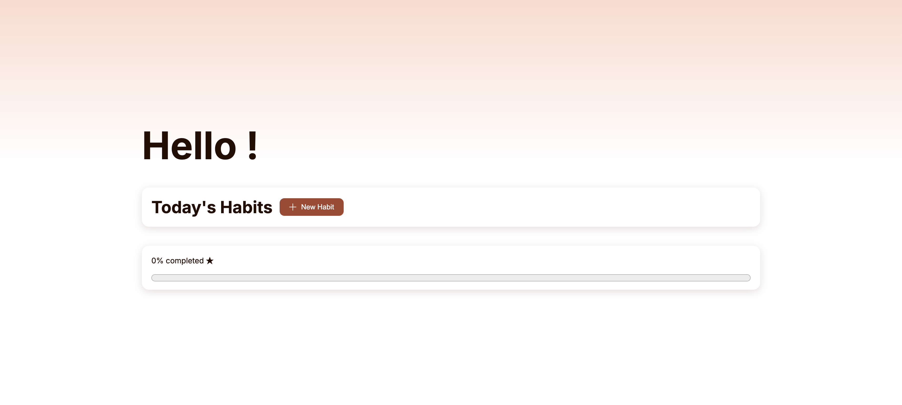

# Habit Tracker

Un habit tracker minimaliste : cocher ses habitudes, sans dashboard, ni fonctionnalités superflues.

🔗 [**Voir le site en ligne**](https://laura-mongin.github.io/habit-tracker/)

## Pourquoi ce projet

J'aime suivre mon quotidien, mais je reviens toujours au papier : il est simple, toujours disponible, et il ne me demande rien de plus que de cocher. J'ai testé beaucoup d'applications de suivi d'habitudes, mais la plupart ajoutent des dashboards et des fonctionnalités dont je n'ai pas besoin. Aujourd'hui, je n'en utilise qu'une au quotidien, pour suivre mes pages lues.

Ce projet part d'une contrainte : **offrir la simplicité du papier, avec la disponibilité d'une app**. Pas de gros tableau de bord : une simple barre de progression suffit pour voir où j'en suis dans ma journée. C'est aussi l'occasion de pratiquer JavaScript sur un projet concret.

## Fonctionnalités

- Ajouter / modifier / supprimer une habitude
- Cocher une habitude
- Barre de progression (éléments cochés / restants)
- Sauvegarde locale

## Reste à intégrer pour la V1

- Bouton de reset manuel
- Affichage responsive (mobile et tablette)

## Roadmap

**V2 : un vrai suivi dans le temps** (développée sur la branche `v2`)

- Mémoire à long terme (historique conservé)
- Reset journalier automatique (remplace le reset manuel)
- Découpe du suivi par jour

## Stack

HTML, CSS et JavaScript vanilla, volontairement sans framework, pour travailler les fondamentaux : manipulation du DOM, gestion d'état, opérations CRUD et persistance des données dans le navigateur.

## Lancer le projet

1. Cloner le dépôt : `git clone https://github.com/laura-mongin/habit-tracker.git`
2. Ouvrir `index.html` dans le navigateur. Aucune installation nécessaire.

## Statut

🚧 V1 en cours de finalisation, mise en pause le temps de me concentrer sur [Multisport](https://github.com/laura-mongin/multisport), mon projet principal. Je la terminerai une fois la première version de Multisport prête. La V2 transformera ensuite l'outil en habit tracker complet, avec un suivi jour par jour.